# 퇴사각 펫 — 개발 DB 관계도 (ERD)

> DB: **Supabase (PostgreSQL, 서울 리전)** — 구조 결정 배경은 [기술스택.md](기술스택.md)
> 실제 테이블 정의: [schema.sql](schema.sql) — ⚠️ 아직 SQLite 버전. 이 문서 기준으로 PostgreSQL 버전으로 바꿔야 함
> 점수 규칙: 모든 답변은 `normalized_score` **0~100** 으로 바꿔 저장, **100에 가까울수록 퇴사각 높음**
> **점수·경험치 계산은 DB 함수/트리거에서만** 함. 앱은 원본 입력만 보내고 계산 결과는 읽기만 함 (조작 방지)
> **민감한 자유 입력(메모 3종, 자유 입력 답변)은 암호화해서 저장**

## 1. 전체 관계도

```mermaid
erDiagram
    auth_users ||--|| users : "Supabase 로그인 계정"
    users ||--o| admin_users : "관리자 권한"
    admin_users ||--o{ admin_audit_logs : "관리자 행동"
    users ||--o{ admin_audit_logs : "대상 사용자"

    users ||--o{ user_goals : "목표(후순위)"
    users ||--o{ question_deliveries : "질문 받음"
    users ||--o{ answers : "답변"
    users ||--o{ daily_records : "하루 기록(1일 1행)"
    users ||--o{ work_logs : "업무 기록"
    users ||--o{ score_snapshots : "퇴사각 지수 캐시"
    users ||--o{ user_pets : "보유 펫"
    users ||--o{ exp_events : "경험치"
    users ||--o{ pet_interactions : "인터랙션"
    users ||--o{ user_pet_items : "보유 장신구"

    indicators ||--o{ questions : "지표별 질문"
    indicators ||--o{ score_snapshots : "지표별 점수"
    questions ||--o{ question_options : "선택지"
    questions ||--o{ question_deliveries : "노출"
    question_deliveries ||--o| answers : "1노출 1답변"
    question_options ||--o{ answers : "선택된 보기"
    worker_types ||--o{ score_snapshots : "직장인 유형"

    pet_species ||--o{ user_pets : "캐릭터 종류"
    user_pets ||--o{ exp_events : "성장"
    user_pets ||--o{ pet_interactions : "클릭/쓰다듬기"
    user_pets ||--o{ user_pet_items : "장착(후순위)"
    pet_items ||--o{ user_pet_items : ""

    users {
        uuid id PK "= auth.users.id"
        text nickname
        time work_start_time "출근 09:00"
        time work_end_time "퇴근 18:00"
        time lunch_time "12:00"
        time daily_question_time "16:00"
        int daily_question_count "2"
        text timezone "Asia/Seoul"
        bool tutorial_done
        text status "ACTIVE | SUSPENDED | DELETED"
        timestamptz suspended_at
        timestamptz deleted_at
        timestamptz privacy_agreed_at "서버 저장·관리자 열람 동의"
        text privacy_version "동의한 처리방침 버전"
    }
    admin_users {
        uuid user_id PK,FK
        text role "CONTENT | SUPPORT | SUPER"
        uuid granted_by FK
        timestamptz granted_at
    }
    admin_audit_logs {
        bigint id PK
        uuid admin_id FK
        text action "VIEW | UPDATE | DELETE | SUSPEND | CONTENT_EDIT ..."
        uuid target_user_id FK "NULL=콘텐츠 수정"
        text target_table
        bigint target_id
        jsonb before_data "암호화 컬럼은 값 대신 '변경됨'"
        jsonb after_data
        text reason "열람·수정 사유(필수)"
        timestamptz created_at
    }
    indicators {
        bigint id PK
        text code UK "RESIGN_URGE, SALARY..."
        text category "LONG | SHORT | WORK_LOG"
        text cycle "DAILY | WEEKLY | MONTHLY | QUARTERLY"
        text direction "NEGATIVE | POSITIVE(역산)"
        real weight
        bool is_active
    }
    questions {
        bigint id PK
        bigint indicator_id FK
        text text
        text answer_type "CHOICE | EMOJI | SLIDER | TEXT | YES_NO"
        real min_value
        real max_value
        text min_label
        text max_label
        int version "문구 수정 시 +1"
        bool is_active
    }
    question_options {
        bigint id PK
        bigint question_id FK
        int sort_order
        text label
        text emoji
        real raw_score
    }
    question_deliveries {
        bigint id PK
        uuid user_id FK
        bigint question_id FK
        int question_version "낼 때의 문구 버전"
        text period_key "D:2026-11-14 / Q:2026-Q4"
        text draw_group "장기 3장 중 1장"
        text channel "BUBBLE | NOTE | CARD"
        text status "PENDING | ANSWERED | SKIPPED | EXPIRED"
        timestamptz delivered_at
        timestamptz expires_at
    }
    answers {
        bigint id PK
        bigint delivery_id FK,UK
        uuid user_id FK
        bigint question_id FK
        date answer_date
        bigint option_id FK
        real raw_value
        bytea text_value_enc "자유 입력, 암호화"
        real normalized_score "0~100, DB 트리거가 계산"
    }
    daily_records {
        bigint id PK
        uuid user_id FK
        date record_date "user당 UNIQUE"
        smallint mood_morning "1~5"
        smallint mood_afternoon
        smallint mood_evening
        bool is_overtime
        int overtime_minutes
        bytea memo_today_enc "암호화"
        bytea memo_stress_cause_enc "암호화"
        bytea memo_moment_enc "암호화"
    }
    work_logs {
        bigint id PK
        uuid user_id FK
        date log_date
        text log_type "MEETING | TASK_DONE | TASK_NEW"
        text title
        int quantity
    }
    score_snapshots {
        bigint id PK
        uuid user_id FK
        text period_type "DAY | WEEK | MONTH | QUARTER"
        text period_key
        bigint indicator_id FK "NULL=전체 지수"
        real short_score
        real long_score
        real score
        int answer_count
        bigint worker_type_id FK
        bool is_dirty "재계산 필요"
        timestamptz computed_at
    }
    worker_types {
        bigint id PK
        text code UK
        text name
        text description
        jsonb rule_json
    }
    pet_species {
        bigint id PK
        text code UK
        text name
        text rarity
        text asset_key
        bool is_active
    }
    user_pets {
        bigint id PK
        uuid user_id FK
        bigint species_id FK
        text name
        int level "트리거가 계산"
        int total_exp "트리거가 계산"
        int affection "트리거가 계산"
        bool is_active
    }
    exp_events {
        bigint id PK
        uuid user_id FK
        bigint user_pet_id FK
        text source_type "ANSWER | DAILY_RECORD | WORK_LOG ..."
        bigint source_id
        int exp_delta
        bool is_reversal "역분개 행"
    }
    pet_interactions {
        bigint id PK
        uuid user_id FK
        bigint user_pet_id FK
        text interaction_type "CLICK | DRAG | PET | TALK"
        timestamptz occurred_at
    }
    pet_items {
        bigint id PK
        text code UK
        text slot
        text asset_key
    }
    user_pet_items {
        bigint user_pet_id PK,FK
        bigint item_id PK,FK
        uuid user_id FK
        bool is_equipped
    }
    user_goals {
        bigint id PK
        uuid user_id FK
        text goal_code
    }
    events {
        bigint id PK
        text code UK
        text name
        timestamptz starts_at
        timestamptz ends_at
        jsonb config "보상·한정 대사·질문 등"
        bool is_active
    }
```

**FK 없이 혼자 쓰는 테이블 (콘텐츠 마스터 데이터)**
- `pet_state_rules` — 상태 코드 · 우선순위 · 조건(`jsonb`) · 애니메이션 키
- `pet_dialogues` — 대사 (시간대 고정 / 랜덤 / 기록 기반 맞춤), 조건은 `jsonb`
- `events` — 기간 한정 이벤트 (관리자가 앱 업데이트 없이 등록)

**공통 컬럼 (그림에서는 생략)**
- 모든 테이블: `created_at timestamptz default now()`, 수정되는 테이블은 `updated_at`
- 콘텐츠 테이블(`indicators`, `questions`, `question_options`, `worker_types`, `pet_species`, `pet_items`, `pet_state_rules`, `pet_dialogues`, `events`): `updated_by uuid` (수정한 관리자)

**SQLite → PostgreSQL 타입 변환 규칙**

| SQLite (기존) | PostgreSQL |
| --- | --- |
| `INTEGER PRIMARY KEY AUTOINCREMENT` | `bigint generated always as identity` |
| `users.id` / 모든 `user_id` | `uuid` (`auth.users.id` 참조, 계정 삭제 시 `on delete cascade`) |
| 날짜·시간 `TEXT` | `date` / `time` / `timestamptz` |
| 0/1 `INTEGER` | `boolean` |
| JSON `TEXT` | `jsonb` |
| `datetime('now')` | `now()` |
| `COALESCE(indicator_id, 0)` 유니크 인덱스 | `UNIQUE NULLS NOT DISTINCT (user_id, period_type, period_key, indicator_id)` |

## 2. 테이블 묶음별 역할

| 묶음 | 테이블 | 기획 기능 |
| --- | --- | --- |
| 사용자 | `users`, `user_goals`(후순위) | 출퇴근·점심 시간, 질문 시각, 튜토리얼 여부, 계정 상태, 개인정보 동의 |
| 관리자 | `admin_users`, `admin_audit_logs` | 관리자 권한 구분, 열람·수정 기록 |
| 질문 마스터 | `indicators`, `questions`, `question_options` | 장기 8개 / 단기 7개 / 업무 기록 지표, 4가지 답변 형식 |
| 질문·답변 | `question_deliveries`, `answers` | 노출 주기, 중복 방지, 답변 저장 |
| 기록 | `daily_records`, `work_logs` | 오전·오후·퇴근 기분, 야근, 메모 3종(암호화), 회의·업무 건수 |
| 퇴사각 지수 | `score_snapshots`, `worker_types` | 항목별/전체 점수, 기간별 비교, 캘린더 색상, 직장인 유형 |
| 펫 | `pet_species`, `user_pets`, `exp_events`, `pet_interactions`, `pet_items`(후순위) | 캐릭터 뽑기, 레벨·경험치, 애정도, 장신구 |
| 펫 콘텐츠 | `pet_state_rules`, `pet_dialogues` | 상태 우선순위, 대사 |
| 이벤트 | `events` | 기간 한정 이벤트 |

## 3. 기획서 "개발 유의사항" → DB에서 이렇게 해결

### ① 노출 주기 · 중복 응답 방지
- 질문 뽑기는 **DB 함수 `draw_daily_questions()`** 가 함 (앱이 16:00 에 호출, 여러 번 호출해도 결과 같음)
  - 오늘 `D:` 키로 아직 안 나간 단기 질문 중 랜덤 2개, 최근 3일 안에 나온 질문은 가중치 낮춤
  - 날짜는 `users.timezone` 기준으로 계산
- 질문을 낼 때마다 `question_deliveries` 에 한 행 생성, **`UNIQUE(user_id, question_id, period_key)`**
  - 단기(매일): `D:2026-11-14` → 같은 날 같은 질문 두 번 안 나옴
  - 장기(월/분기): `M:2026-11`, `Q:2026-Q4` → 그 달/분기에 한 번만
- `question_version` 에 **낼 때의 문구 버전**을 저장 → 관리자가 나중에 문구를 고쳐도 과거 답변이 어떤 문구에 대한 답이었는지 알 수 있음
- `answers.delivery_id` 가 UNIQUE → 한 번 낸 질문엔 답 하나만
- 장기 "3장 중 1장 고르기": 카드 3개를 같은 `draw_group` 으로 생성 → 고른 1개 `ANSWERED`, 나머지 `SKIPPED`
  → SKIPPED 된 질문은 그 기간에 다시 뽑힐 수 있게 할지 정책 결정 필요

### ② 답변 형식 표준화 (객관식·이모지·슬라이더·자유입력)
- 앱은 **DB 함수 `submit_answer(delivery_id, option_id | raw_value | text)`** 로 원본 입력만 보냄
  - 함수가 확인: 내 질문인지, `PENDING` 인지, 만료 안 됐는지
  - `normalized_score` 는 **트리거가 계산**해서 채움 (앱이 보낸 값은 무시)
  - 자유 입력은 암호화해서 `text_value_enc` 에 저장 (→ ⑧)
  - 노출 상태를 `ANSWERED` 로 변경

| 형식 | 저장 | normalized_score |
| --- | --- | --- |
| 객관식 5지선다 / 이모지 | `option_id` + 선택지의 `raw_score` → `raw_value` | `(raw - min) / (max - min) × 100` |
| 슬라이더 | `raw_value` | 위와 동일 |
| 예/아니오 (야근) | `raw_value` 0/1 | 0 또는 100 |
| 자유 입력 | `text_value_enc` (암호화) | **NULL → 점수 계산에서 제외** (나중에 감정분석 붙이면 채움) |

- 지표 `direction = POSITIVE`(성취감·만족도 질문)는 `100 - 값` 으로 뒤집어서 저장 → 전부 "높을수록 퇴사각↑"로 통일

### ③ 퇴사각 지수 계산 · 미응답 처리 — DB 함수 (제안안, 팀 확정 필요)
- 계산은 **DB 함수 `recalc_scores(user_id)`** 에서만 함. 앱은 `score_snapshots` 를 읽기만 가능
- **단기 점수** = 최근 7일 단기 답변 `normalized_score` 의 가중 평균 (`indicators.weight`)
- **장기 점수** = 장기 지표별 **가장 최근 답변을 이월**해서 평균 (분기 질문은 다음 답변 전까지 유지)
- **종합 퇴사각 지수** = `단기 × 0.6 + 장기 × 0.4`
  - 장기 답변이 하나도 없으면 단기만 사용
  - `answer_count` 가 기준(예: 7일 중 3일) 미만이면 화면에 "아직 데이터가 부족해요" 표시
- 캘린더 한 칸 = `score_snapshots (period_type='DAY', indicator_id=NULL)` 한 행
  → 기획의 "질문 2개 평균값으로 캘린더 DB에 기록" 과 같은 방식
- 직장인 유형: 지표별 점수를 `worker_types.rule_json` 구간과 비교해서 매칭 (같은 함수 안에서)

### ④ 조회 성능 · 과거 수정 시 재계산
- 캘린더·그래프는 원본 `answers` 를 매번 계산하지 않고 `score_snapshots` 만 읽음
- **트리거가 dirty 표시**: `answers` · `daily_records` 가 추가·수정·삭제되면 (사용자든 관리자든) 해당 날짜의 DAY 행과 그 날이 포함된 WEEK/MONTH/QUARTER 행을 `is_dirty = true`
- **재계산 시점**
  - 앱이 캘린더·대시보드를 열 때 `get_scores(from, to)` 호출 → dirty 행만 재계산 후 반환
  - 매일 새벽 `pg_cron` 으로 전체 dirty 행 정리 (관리자가 고친 기록도 다음 날엔 반영)
- 여러 사용자가 한 DB 에 모이므로 인덱스는 항상 `(user_id, 날짜)` 로: `answers(user_id, answer_date)`, `work_logs(user_id, log_date)`, `daily_records(user_id, record_date)`

### ⑤ 업무 기록 ↔ 경험치 ↔ 펫 성장 — DB 트리거
- 답변·기록·업무 로그가 생기면 **트리거가** `exp_events` 에 한 행 추가 (`source_type` + `source_id`). 앱은 경험치를 직접 못 씀
- `UNIQUE(source_type, source_id, user_pet_id, is_reversal)` → 같은 기록으로 경험치 두 번 받기 방지
  - 🔧 기존 `UNIQUE(source_type, source_id, user_pet_id)` 는 역분개 행이 같은 키를 가져서 **저장이 안 되는 버그** → `is_reversal` 추가로 해결
- 기록을 지우면 트리거가 `exp_delta` 음수 + `is_reversal = true` 행 추가 → `user_pets.total_exp/level` 은 트리거가 갱신하는 캐시 (합계로 언제든 재계산 가능)
- `affection` 도 `pet_interactions` 트리거가 올림 (짧은 시간 연타는 한 번만 인정하는 제한 필요)

### ⑥ 펫 상태 우선순위
- 상태는 DB에 저장하지 않고 **앱 실행 중 실시간 계산**, 규칙만 `pet_state_rules` 에 둠 (관리자가 수정 가능, 앱은 시작할 때 받아옴)
- 여러 조건이 동시에 맞으면 `priority` 가 가장 큰 규칙 하나 적용. 예시 우선순위:

| 우선순위 | 상태 | 조건 |
| --- | --- | --- |
| 100 | 사용자 반응 (놀람·좋아함) | 클릭/드래그/쓰다듬기 직후 몇 초 |
| 90 | 질문 쪽지 (머리 위 쪽지·전구) | PENDING 질문 있음 |
| 80 | 퇴근 독촉 | 퇴근 시간 지났는데 PC 사용 중 |
| 70 | 위로하기 | 오늘/최근 스트레스 점수 ≥ 70 |
| 60 | 같이 일하기·응원 | 키보드·마우스 계속 사용 중 + 펫과 상호작용 없음(바쁨) |
| 50 | 시간대 행동 | 아침 인사 / 점심 휴식 / 오후 졸기 |
| 10 | 기본 (돌아다니기·랜덤 혼잣말 말풍선) | 그 외 |

- "바쁨" 판정은 OS 유휴시간(입력 없는 시간) API로 계산 → [기술스택.md](기술스택.md) 참고

### ⑦ 접근 권한 (RLS)
기본 규칙: **사용자는 `user_id = auth.uid()` 인 자기 데이터만.** 점수·경험치처럼 계산되는 값과 암호화 데이터는 DB 함수를 통해서만 씀.

| 테이블 | 사용자 | 관리자 |
| --- | --- | --- |
| 콘텐츠 (`indicators`, `questions`, `pet_dialogues`, `events` …) | 읽기 (`is_active` 만) | `CONTENT` · `SUPER` 쓰기 (감사 트리거로 자동 기록) |
| `users` | 본인 읽기, 설정 컬럼만 수정 (`status`, 동의 컬럼은 함수로만) | 관리자 함수로만 |
| `question_deliveries` | 본인 읽기. 생성은 `draw_daily_questions()` | 관리자 함수로만 |
| `answers` | 본인 읽기 (자유 입력은 암호문만 보임). 쓰기는 `submit_answer()` | 관리자 함수로만 |
| `daily_records` | `save_daily_record()` / `get_daily_records()` 로만 (암호화 때문) | 관리자 함수로만 |
| `work_logs` | 본인 직접 추가·수정·삭제 (경험치·dirty 는 트리거) | 관리자 함수로만 |
| `score_snapshots`, `exp_events` | 본인 **읽기만** | 관리자 함수로만 |
| `user_pets` | 본인 읽기, `name` · `is_active` 만 수정 | 관리자 함수로만 |
| `pet_interactions`, `user_pet_items` | 본인 추가·읽기, 장착 여부 수정 | 관리자 함수로만 |
| `admin_users`, `admin_audit_logs` | 접근 불가 | `SUPER` 만 (감사 로그는 추가만, 수정·삭제 불가) |

### ⑧ 메모 · 자유 입력 암호화
- 대상: `daily_records` 의 메모 3종(`memo_today`, `memo_stress_cause`, `memo_moment`), `answers` 의 자유 입력
- 방식: **서버 키 암호화** — `pgcrypto` 의 `pgp_sym_encrypt` 로 암호화해서 `bytea` 컬럼(`*_enc`)에 저장
  - 암호화 키는 **Supabase Vault** 에 보관, `security definer` DB 함수 안에서만 꺼내 씀
  - 앱은 평문으로 보내고(HTTPS) `save_daily_record()` 가 암호화, `get_daily_records()` 가 본인 것만 복호화해서 반환
  - 관리자는 `admin_get_user_records()` 로만 복호화된 메모를 볼 수 있고, 볼 때마다 감사 로그 기록
- 막아주는 것: DB 백업·테이블 데이터 유출, 관리 화면(테이블 편집기)에서 우연히 보는 것
- 못 막는 것: Supabase 프로젝트 최고 권한자(키에 접근 가능) → 최고 권한자 수 최소화, 키 접근도 기록
- 감사 로그(`before_data`/`after_data`)에는 메모 원문을 남기지 않고 "변경됨" 만 기록

### ⑨ 관리자 기능 · 감사 로그
- 관리자는 사용자 데이터 테이블을 **직접 읽지 못함** → 아래 관리자 전용 DB 함수로만 접근
- 모든 관리자 함수: ① 관리자 권한(`admin_users.role`) 확인 → ② `admin_audit_logs` 기록 (사유 필수) → ③ 실행
- 사용자 기록을 고치면 ④ 의 트리거가 점수를 dirty 로 표시 → 재계산됨

| 권한 | 할 수 있는 일 |
| --- | --- |
| `CONTENT` | 질문·대사·아이템·펫 종류·이벤트 수정 |
| `SUPPORT` | 계정 조회·정지, 개인 기록 열람·수정 (문의 대응) |
| `SUPER` | 전부 + 관리자 임명, 감사 로그 열람 |

## 4. DB 함수 · 트리거 목록

| 이름 | 종류 | 호출 | 하는 일 |
| --- | --- | --- | --- |
| `draw_daily_questions()` | 함수 | 앱 (16:00) | 오늘의 단기 질문 뽑아서 `question_deliveries` 생성 |
| `draw_long_cards()` | 함수 | 앱 | 장기 지표 카드 3장 뽑기 |
| `submit_answer(...)` | 함수 | 앱 | 답변 검증·저장, 자유 입력 암호화, 노출 상태 변경 |
| `save_daily_record(...)` / `get_daily_records(from, to)` | 함수 | 앱 | 하루 기록 저장(암호화) / 조회(복호화) |
| `get_scores(from, to)` | 함수 | 앱 | dirty 재계산 후 점수 반환 |
| `recalc_scores(user_id)` | 내부 함수 | 위 함수, `pg_cron` | 단기·장기·종합 점수, 직장인 유형 계산 |
| `trg_normalize_answer` | 트리거 | `answers` 추가·수정 | `normalized_score` 계산 |
| `trg_mark_scores_dirty` | 트리거 | `answers`, `daily_records` 변경 | 관련 기간 `is_dirty = true` |
| `trg_grant_exp` | 트리거 | `answers`, `daily_records`, `work_logs` 변경 | `exp_events` 추가·역분개, `user_pets` 갱신 |
| `trg_affection` | 트리거 | `pet_interactions` 추가 | 애정도 증가 (연타 제한) |
| `trg_audit_content` | 트리거 | 콘텐츠 테이블 변경 | 감사 로그 기록, `updated_by` 채움 |
| `admin_get_user_records(user_id, reason)` | 관리자 함수 | 관리자 웹 | 개인 기록 열람 (복호화) + 감사 로그 |
| `admin_update_record(table, id, data, reason)` | 관리자 함수 | 관리자 웹 | 개인 기록 수정 + 감사 로그 (변경 전후) |
| `admin_set_user_status(user_id, status, reason)` | 관리자 함수 | 관리자 웹 | 계정 정지·해제·삭제 |
| `admin_get_stats(from, to)` | 관리자 함수 | 관리자 웹 | 사용자 수, 질문별 응답률, 평균 퇴사각 (집계만, 개인 식별 불가) |

## 5. 팀에서 정해야 할 것
1. 종합 지수 비율(단기 0.6 / 장기 0.4)과 "데이터 부족" 기준
2. 장기 3장 중 안 고른 카드를 같은 기간에 다시 낼지
3. 단기 질문 7개 각각의 답변 형식 (예: 야근 = 예/아니오, 나머지 = 슬라이더 or 5지선다)
4. 경험치 표: 답변 1개 / 하루 기록 / 업무 완료 1건 당 몇 exp, 레벨업 곡선
5. 직장인 유형 개수와 점수 구간
6. **메모 암호화 수준**: 지금 안은 서버 키 방식(관리자가 감사 로그를 남기고 열람 가능). 관리자에게도 메모를 완전히 가리려면 사용자 기기에서만 풀리는 종단간 암호화로 바꿔야 하는데, 그러면 관리자 열람·수정이 메모에는 불가능
7. `work_logs.title`(업무 제목)도 암호화할지 — 회사 업무 내용이 들어갈 수 있음
8. 계정 삭제 시 데이터 보관 기간 (즉시 삭제 vs 일정 기간 후 삭제), 감사 로그 보관 기간
9. 애정도 연타 제한 기준 (예: 같은 펫에 1분에 1회만 인정)
