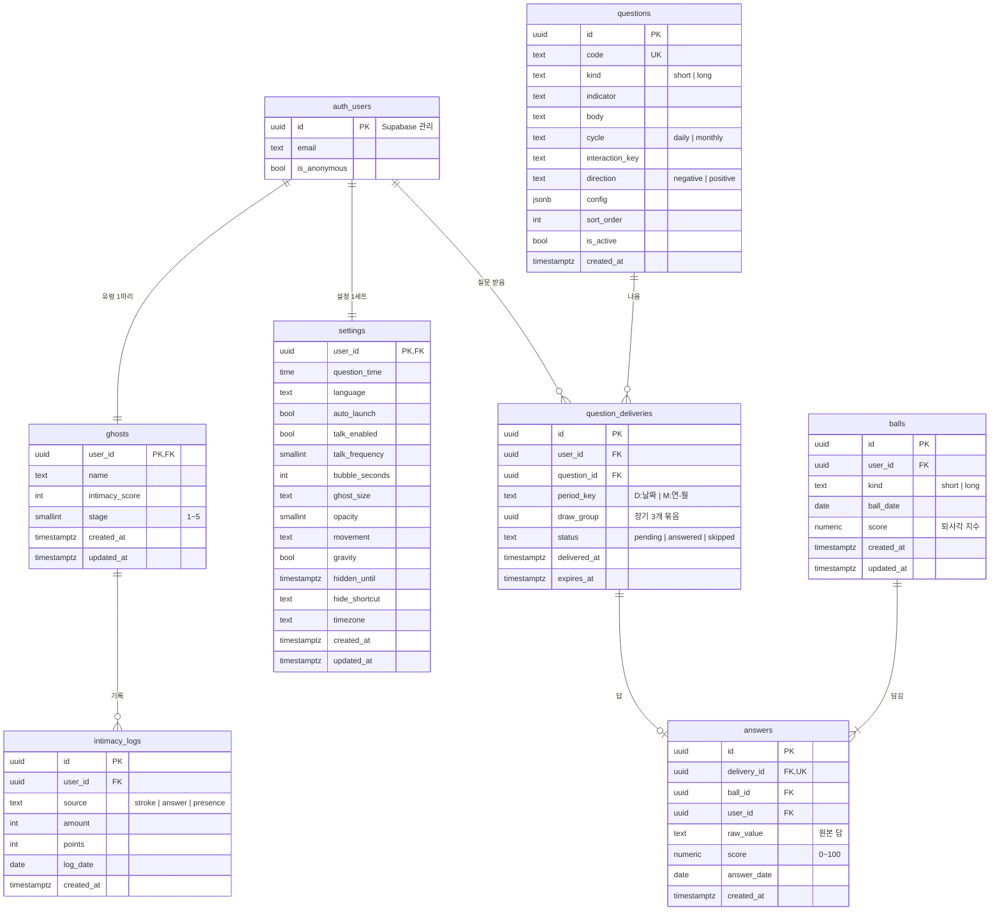

# 퇴사각 펫 — 전체 ERD

> 테이블 8개를 하나로 합친 관계도. 각 테이블의 자세한 설명 · 예시 · SQL 은 [00-진행현황.md](00-진행현황.md) 의 문서를 봄
> 기준: [기획정리.md](../기획정리.md) · 미정 사항: [기획정리_추가정리필요요소.md](../기획정리_추가정리필요요소.md) · 기초: [Supabase 구조](00-supabase-구조.md)
> 그림 파일: [ERD.png](ERD.png) (mermaid 를 못 보는 곳에서는 이 이미지를 봄)

## 한 줄 요약
- **사용자는 `auth.users`** (Supabase 가 관리) 하나. 그 사용자에게 질문이 나오고(`question_deliveries`), 답하면(`answers`) 구슬(`balls`)에 담기고 친밀도(`ghosts`, `intimacy_logs`)가 오름. 취향은 `settings`
- 질문 · 답 · 구슬 · 친밀도는 **전부 DB 함수가 만들고 바꿈**. 앱은 읽기만 함 (조작 방지). 이름과 설정만 앱이 직접 바꿈

## 관계도



- `answers` · `balls` 에도 `user_id` 가 있음 (`auth.users.id` 를 가리킴, RLS 용). 그림에서는 선을 생략함
- `intimacy_logs.user_id` 는 `ghosts.user_id` 를 가리킴 (유령 = 사용자당 1마리)

## 관계 표

| 관계 | 연결 칸 | 뜻 |
| --- | --- | --- |
| `auth.users` 1 ↔ 1 `ghosts` | `ghosts.user_id` (기본키) | 사용자당 유령 1마리 |
| `auth.users` 1 ↔ 1 `settings` | `settings.user_id` (기본키) | 사용자당 설정 1세트 |
| `auth.users` 1 → N `question_deliveries` | `user_id` | 매일 · 매달 질문이 나옴 |
| `questions` 1 → N `question_deliveries` | `question_id` | 한 질문이 여러 사람 · 여러 날 나옴 |
| `question_deliveries` 1 → 0~1 `answers` | `answers.delivery_id` (unique) | 나온 질문에 답은 하나 (안 할 수도 있음) |
| `balls` 1 → 1~3 `answers` | `answers.ball_id` | 오늘의 구슬엔 답 1~3개, 특별한 구슬엔 1개 |
| `ghosts` 1 → N `intimacy_logs` | `intimacy_logs.user_id` | 친밀도가 오를 때마다 한 줄 |

## 테이블 한눈에 보기

| # | 테이블 | 한 줄 설명 | 누가 채우나 | 앱 권한 | 문서 |
| --- | --- | --- | --- | --- | --- |
| – | `auth.users` | 사용자 (로그인 정보) | Supabase | 본인 정보만 | [01](01-users.md) |
| 2 | `questions` | 질문 8개 (단기 5 + 장기 3) | seed | 읽기 | [02](02-questions.md) |
| 3 | `question_deliveries` | 누구에게 언제 어떤 질문이 나왔나 | DB 함수 | 읽기 | [03](03-question-deliveries.md) |
| 4 | `answers` | 내가 한 답 (원본 + 0~100 점수) | DB 함수 | 읽기 | [04](04-answers.md) |
| 5 | `balls` | 구슬 (오늘의 + 특별한), 퇴사각 지수 | DB 함수 | 읽기 | [05](05-balls.md) |
| 6 | `ghosts` | 내 유령 (이름, 친밀도 점수 · 단계) | 가입 트리거 + DB 함수 | 읽기, **이름만 수정** | [06](06-ghosts.md) |
| 7 | `intimacy_logs` | 친밀도가 언제 왜 올랐나 (장부) | DB 함수 | 읽기 | [07](07-intimacy-logs.md) |
| 8 | `settings` | 메뉴 설정값 (전부 Supabase 에 저장) | 가입 트리거 | 읽기 + **수정** | [08](08-settings.md) |

- 공통: `user_id` 로 "내 것만 보이게" RLS. `questions` 만 모두가 같이 읽는 공용 데이터라 `user_id` 가 없음
- `ghosts` · `settings` 는 사용자당 1줄이라 `user_id` 가 기본키 (나머지는 `id` uuid)

## 함수 · 트리거 한눈에 보기

| 이름 | 종류 | 하는 일 | 문서 |
| --- | --- | --- | --- |
| `draw_daily_questions()` | 함수 | 오늘 질문 `short` 5개 중 3개를 랜덤으로 뽑아 `question_deliveries` 3줄 생성 (이미 뽑았으면 같은 3줄) | [03](03-question-deliveries.md) |
| `draw_monthly_questions()` | 함수 | 이번 달 `long` 3개를 한 묶음(`draw_group`)으로 생성 | [03](03-question-deliveries.md) |
| `submit_answer()` | 함수 | 답 검증 → 점수 계산 → 구슬 찾기 · 만들기 → `answers` 저장 → 질문 상태 변경 → 구슬 점수 갱신 → 친밀도 요인 `answer` 쌓기 | [04](04-answers.md) · [05](05-balls.md) |
| `add_intimacy()` | 함수 | `stroke` · `presence` 로 친밀도 기록 쌓기 (`presence` 는 지난 시간 이하로 자름) | [07](07-intimacy-logs.md) |
| `intimacy_stage(score)` | 함수 | 점수 → 단계(1~5). 경계값은 A-5 에서 정함 | [06](06-ghosts.md) |
| `handle_new_user` | 트리거 (`auth.users` 에 줄이 생길 때) | `ghosts` · `settings` 를 기본값으로 1줄씩 생성 | [06](06-ghosts.md) · [08](08-settings.md) |
| `add_points_to_ghost` | 트리거 (`intimacy_logs` 에 줄이 생길 때) | `ghosts.intimacy_score` 에 점수를 더함 | [07](07-intimacy-logs.md) |
| `sync_ghost_stage` | 트리거 (`ghosts.intimacy_score` 가 바뀔 때) | `ghosts.stage` 를 점수로 다시 계산 | [06](06-ghosts.md) |

## 데이터가 흐르는 모습

```
[질문 받을 시간 ±20분 랜덤]
      │ 앱이 draw_daily_questions() 호출
      ▼
question_deliveries (오늘 3줄, pending)
      │ 사용자가 답함 → 앱이 submit_answer() 호출
      ▼
answers (답 1줄) ──▶ balls (오늘의 구슬: 첫 답이면 생성, 이후 답은 같은 구슬에 담김, 퇴사각 지수 갱신)
      │
      └──▶ intimacy_logs (answer) ──▶ ghosts.intimacy_score += points ──▶ ghosts.stage 자동 계산

유령을 쓰다듬거나 켜 두면: 앱이 add_intimacy() → intimacy_logs (stroke / presence) → 위와 같은 흐름
이달의 질문(월 1회): draw_monthly_questions() → 3개 중 1개 답 → 특별한 구슬(long) 생성
```

## 만드는 순서 (마이그레이션)

외래키가 가리키는 쪽을 먼저 만듦

| 순서 | 만들 것 | 이유 |
| --- | --- | --- |
| 1 | `questions` (+ seed 8개) | `question_deliveries` 가 가리킴 |
| 2 | `settings` | 가입 트리거가 insert 함 |
| 3 | `ghosts` + `intimacy_stage` · `sync_ghost_stage` | `intimacy_logs` 가 가리킴 |
| 4 | `handle_new_user` 트리거 | `ghosts` · `settings` 가 있어야 함 |
| 5 | `intimacy_logs` + `add_points_to_ghost` | `ghosts` 가 있어야 함 |
| 6 | `question_deliveries` | `questions` 가 있어야 함 |
| 7 | `balls` | `answers` 가 가리킴 |
| 8 | `answers` | `question_deliveries` · `balls` 가 있어야 함 |
| 9 | 함수 `draw_daily_questions` · `draw_monthly_questions` · `submit_answer` · `add_intimacy` | 테이블이 다 있어야 함 |

## 아직 정해지지 않은 것

테이블 **구조(칸)는 거의 확정**이고, 아래는 **값 · 계산식**이라 정해지면 함수나 seed 만 바뀜

| 항목 | 영향받는 곳 |
| --- | --- |
| [A-5](../기획정리_추가정리필요요소.md) 친밀도: 요인별 점수, 단계가 오르는 점수(예: 100점) | `add_intimacy` · `submit_answer` · `intimacy_stage` |
| [A-9](../기획정리_추가정리필요요소.md) 답변 → 점수(0~100) 변환 규칙 | `submit_answer` · `questions.config` |
| [A-10](../기획정리_추가정리필요요소.md) 퇴사각 지수 계산 (지금은 그날 답의 평균으로 임시) | `balls.score` 를 채우는 함수 |
| [A-6](../기획정리_추가정리필요요소.md) 장기 질문이 나오는 날짜(매달 며칠) | `draw_monthly_questions` |
| [B-1](../기획정리_추가정리필요요소.md) 컴퓨터가 꺼져 있었으면 켤 때 질문이 도착하는지 | 앱 로직 |
| [B-4](../기획정리_추가정리필요요소.md) 답변 수정 가능 여부 | `answers.updated_at` 추가 여부 |
| [B-9](../기획정리_추가정리필요요소.md) 첫 실행에 이름을 받는지 | `ghosts.name` 의 `not null` 여부 |
| [C-5](../기획정리_추가정리필요요소.md) 언어 범위 | `settings.language` 의 `check` |
| 기기마다 다른 설정(자동 실행 · 단축키 · 숨김) | 컴퓨터를 여러 대 쓰게 되면 `device_settings` 추가 ([08 메모](08-settings.md)) |
