# 퇴사각 펫 — 개발 DB 관계도 (ERD)

> DB: **Supabase (PostgreSQL, 서울 리전)** — 구조 결정 배경은 [기술스택.md](기술스택.md)
> 이전 테이블 정의였던 `schema.sql`(SQLite 버전)은 삭제됨. 새 설계는 [erd/ERD.md](../erd/ERD.md)
> 점수 규칙: 모든 답변은 `normalized_score` **0~100** 으로 바꿔 저장, **100에 가까울수록 퇴사각 높음**
> **점수·경험치 계산은 DB 함수/트리거에서만** 함. 앱은 원본 입력만 보내고 계산 결과는 읽기만 함 (조작 방지)
> **민감한 자유 입력(메모 3종, 자유 입력 답변)은 암호화해서 저장**
>
> 📖 처음 읽는다면 [0. 큰 그림](#0-큰-그림) → [6. 테이블별 설명 (읽는 순서대로)](#6-테이블별-설명-읽는-순서대로) 순서로

## 0. 큰 그림

> **관리자가 질문을 만들고 → 사용자가 답하고 기록하면 → DB 가 점수를 매기고 펫을 키운다.**

### 전체 지도

```
                         ┌──────────┐
                         │  users   │
                         └────┬─────┘
          ┌───────────────────┼───────────────────┐
          ▼                   ▼                   ▼
   ┌─────────────┐     ┌─────────────┐     ┌─────────────┐
   │ ① 질문·답변  │     │ ② 일상 기록    │     │   ④ 펫      │
   └──────┬──────┘     └──┬───────▲──┘     └──────▲──────┘
          │               │       │               │
          └───────┬───────┘       │               │
                  ▼               │               │
           ┌─────────────┐        │               │
           │ ③ 퇴사각 점수 │────────┘               │
           └─────────────┘                        │
            기록이 생기면 경험치 지급 ──────────────────┘

   [⑤ 관리자]  관리자 명단 · 감사 로그
```

| 화살표 | 의미 |
| --- | --- |
| ①② → ③ | 답변과 하루 기록으로 퇴사각 점수를 계산 |
| ③ → ② | 계산된 점수를 일상 기록 화면(캘린더 · 하루 히스토리)에 날짜별로 함께 보여줌 |
| ①② → ④ | 답변 · 기록이 생기면 펫에게 경험치 지급 |

**콘텐츠** — 관리자가 만들고, 모든 사용자가 같이 읽음. 어느 덩어리에 쓰이는지로 나눔

```
[콘텐츠]
 ├─ 질문 콘텐츠 ──────────────→ ① 질문·답변에 사용
 │   ├─ 지표 (indicators)            스트레스, 퇴사 충동, 연봉 만족 …
 │   ├─ 질문 (questions)             "오늘 스트레스는 어느 정도였나요?"
 │   └─ 선택지 (question_options)     😊 😐 😫 + 보기마다 점수
 │
 ├─ 점수 콘텐츠 ──────────────→ ③ 퇴사각 점수에 사용
 │   └─ 직장인 유형 (worker_types)     "번아웃 직전형" + 판정 조건
 │
 ├─ 펫 콘텐츠 ────────────────→ ④ 펫에 사용
 │   ├─ 펫 종류 (pet_species)
 │   ├─ 행동 규칙 (pet_state_rules)    "퇴근 시간 지나면 → 퇴근 독촉"
 │   └─ 대사 (pet_dialogues)          "{닉네임}, 오늘 고생했어"
 │
 └─ 운영 콘텐츠 ──────────────→ 전체에 사용
     └─ 이벤트 (events)
```

### 원칙 3개
1. **사용자는 자기 것만 본다** (RLS)
2. **점수와 레벨은 DB 만 계산한다** → 조작 불가
3. **민감한 메모는 암호화한다** → 관리자도 기록을 남겨야만 볼 수 있음

### 한 줄씩 정리

| 덩어리 | 한 줄 | 대표 표 |
| --- | --- | --- |
| ① 질문·답변 | 질문을 내고, 답을 0~100점으로 저장 | `questions`, `question_deliveries`, `answers` |
| ② 일상 기록 | 기분·야근·메모(암호화)·업무를 기록 | `daily_records`, `work_logs` |
| ③ 점수 | ①②를 모아 퇴사각 지수를 계산해 저장 | `score_snapshots` |
| ④ 펫 | 기록하면 경험치, 쓰다듬으면 애정도 | `user_pets`, `exp_events` |
| ⑤ 관리자 | 콘텐츠를 고치고, 사용자 기록은 로그를 남겨야만 접근 | `admin_users`, `admin_audit_logs` |

표는 크게 두 종류:
- **콘텐츠** (관리자가 만듦, 모든 사용자가 같이 읽음): 질문, 선택지, 펫 종류, 대사, 행동 규칙, 이벤트
- **기록** (사용자가 씀 + DB 가 계산, 각자 자기 것만): 답변, 하루 기록, 업무 기록, 점수, 내 펫, 경험치

---

### ① 질문 · 답변 — 앱의 핵심
**하는 일**: 매일 16시에 펫이 질문을 내고, 사용자가 답함

| 표 | 역할 | 종류 |
| --- | --- | --- |
| `indicators` | 측정 항목 (스트레스, 퇴사 충동, 연봉 만족…) | 콘텐츠 |
| `questions` | 항목을 묻는 문장 | 콘텐츠 |
| `question_options` | 객관식 보기와 각 보기의 점수 | 콘텐츠 |
| `question_deliveries` | **누구에게 언제 어떤 질문을 냈나** | 기록 |
| `answers` | **뭐라고 답했나** + 0~100점 | 기록 |

```
16:00  DB 가 오늘의 질문 2개를 뽑음      → question_deliveries 2행 생성 (상태: 대기)
       펫 머리 위에 쪽지가 뜸
사용자  😫 선택                         → answers 1행 생성
       DB 트리거가 😫 → 85점으로 변환     → normalized_score = 85
                                      → question_deliveries 상태: 답함
```

- 질문 형식(이모지, 슬라이더, 예/아니오)이 달라도 **모두 0~100점으로 바꿈** → 평균을 낼 수 있음
- "같은 날 같은 질문 두 번" 은 DB 가 막음

### ② 일상 기록 — 사용자가 직접 쓰는 일기
**하는 일**: 질문과 별개로 사용자가 하루를 기록함

| 표 | 역할 |
| --- | --- |
| `daily_records` | 하루 한 줄: 오전·오후·퇴근 기분, 야근 여부, 메모 3종 (**메모는 암호화**) |
| `work_logs` | 업무 한 건마다 한 줄: 회의, 업무 완료, 새 업무 |

- 기분·야근은 **점수 계산**에, 업무 기록은 **펫 경험치**에 쓰임
- 메모(스트레스 원인 등)는 가장 민감한 정보라 암호화

### ③ 퇴사각 점수 — ①과 ②의 결과물
**하는 일**: 답변과 기록을 모아서 "오늘 퇴사각 72%" 를 계산함

| 표 | 역할 |
| --- | --- |
| `score_snapshots` | **기간별 점수를 미리 계산해 둔 표** (일·주·월·분기 × 항목별·전체) |
| `worker_types` | 점수 패턴 → "번아웃 직전형" 같은 유형 (콘텐츠) |

```
answers, daily_records 변경
    → 트리거: "11/14 점수 다시 계산 필요" 표시 (is_dirty)
사용자가 캘린더를 염
    → DB 함수: 표시된 것만 다시 계산
    → 단기 점수(최근 7일) × 0.6 + 장기 점수(월·분기 질문) × 0.4 = 종합 72점
    → score_snapshots 에 저장 → 캘린더 11/14 칸이 빨간색
```

- 매번 계산하면 느려서 **결과를 저장해 두고, 바뀐 부분만 다시 계산**
- 계산은 **DB 만** 함. 앱은 점수를 직접 쓸 수 없음 → 조작 불가

### ④ 펫 — 기록을 계속하게 만드는 보상
**하는 일**: 기록을 하면 펫이 자라고, 쓰다듬으면 친해짐

| 표 | 역할 | 종류 |
| --- | --- | --- |
| `pet_species` | 펫 종류 (고양이, 강아지…) | 콘텐츠 |
| `user_pets` | 내 펫: 이름, **레벨**, 경험치, **애정도** | 기록 |
| `exp_events` | **경험치 가계부**: 언제 무엇 때문에 몇 점 받았나 | 기록 |
| `pet_interactions` | 클릭·쓰다듬기 기록 | 기록 |
| `pet_state_rules` | "퇴근 시간 지나면 → 퇴근 독촉" 같은 행동 규칙 | 콘텐츠 |
| `pet_dialogues` | 펫 대사 | 콘텐츠 |

```
답변·하루 기록·업무 기록이 생김
    → 트리거: exp_events 에 "+10 (답변 #123)" 추가
    → 트리거: user_pets 의 경험치 합계 갱신 → 레벨업!
쓰다듬기
    → pet_interactions 추가 → 애정도 +1
```

- **레벨** = 기록을 얼마나 했나 (경험치), **애정도** = 펫을 얼마나 쓰다듬었나
- 경험치는 숫자만 두지 않고 **가계부처럼 이력을 남김**. 취소할 때는 지우지 않고 "-10" 줄을 추가
- 펫이 **지금 무슨 행동을 하는지는 DB 에 저장 안 함**. 앱이 규칙을 보고 실시간으로 정함

### ⑤ 관리자 — 운영과 감시

| 표 | 역할 |
| --- | --- |
| `admin_users` | 누가 관리자인지와 권한 (콘텐츠 담당 / 고객 응대 / 최고 관리자) |
| `admin_audit_logs` | 관리자가 **누구의 무엇을, 언제, 왜** 봤는지·고쳤는지. 지울 수 없음 |
| `events` | 기간 한정 이벤트 (경험치 2배 등) |

- 관리자도 사용자 기록을 **직접 못 엶**. 전용 함수를 거쳐야 하고, 그 함수가 사유와 함께 로그를 먼저 남김
- 콘텐츠(①④ 의 콘텐츠 표, 이벤트)는 관리자가 고치면 **앱 업데이트 없이** 바로 반영

---

## 1. 전체 관계도

```mermaid
erDiagram
    auth_users ||--|| users : "Supabase 로그인 계정"
    users ||--o| admin_users : "관리자 권한"
    admin_users ||--o{ admin_audit_logs : "관리자 행동"
    users ||--o{ admin_audit_logs : "대상 사용자"

    users ||--o{ user_goals : "목표(후순위)"
    users ||--o{ question_deliveries : "질문 받음"
    users ||--o{ answers : "답변"
    users ||--o{ daily_records : "하루 기록(1일 1행)"
    users ||--o{ work_logs : "업무 기록"
    users ||--o{ score_snapshots : "퇴사각 지수 캐시"
    users ||--o{ user_pets : "보유 펫"
    users ||--o{ exp_events : "경험치"
    users ||--o{ pet_interactions : "인터랙션"

    indicators ||--o{ questions : "지표별 질문"
    indicators ||--o{ score_snapshots : "지표별 점수"
    questions ||--o{ question_options : "선택지"
    questions ||--o{ question_deliveries : "노출"
    question_deliveries ||--o| answers : "1노출 1답변"
    question_options ||--o{ answers : "선택된 보기"
    worker_types ||--o{ score_snapshots : "직장인 유형"

    pet_species ||--o{ user_pets : "캐릭터 종류"
    user_pets ||--o{ exp_events : "성장"
    user_pets ||--o{ pet_interactions : "클릭/쓰다듬기"

    users {
        uuid id PK "= auth.users.id"
        text nickname
        time work_start_time "출근 09:00"
        time work_end_time "퇴근 18:00"
        time lunch_time "12:00"
        time daily_question_time "16:00"
        int daily_question_count "2"
        text timezone "Asia/Seoul"
        bool tutorial_done
        text status "ACTIVE | SUSPENDED | DELETED"
        timestamptz suspended_at
        timestamptz deleted_at
        timestamptz privacy_agreed_at "서버 저장·관리자 열람 동의"
        text privacy_version "동의한 처리방침 버전"
    }
    admin_users {
        uuid user_id PK,FK
        text role "CONTENT | SUPPORT | SUPER"
        uuid granted_by FK
        timestamptz granted_at
    }
    admin_audit_logs {
        bigint id PK
        uuid admin_id FK
        text action "VIEW | UPDATE | DELETE | SUSPEND | CONTENT_EDIT ..."
        uuid target_user_id FK "NULL=콘텐츠 수정"
        text target_table
        bigint target_id
        jsonb before_data "암호화 컬럼은 값 대신 '변경됨'"
        jsonb after_data
        text reason "열람·수정 사유(필수)"
        timestamptz created_at
    }
    indicators {
        bigint id PK
        text code UK "RESIGN_URGE, SALARY..."
        text name "퇴사 충동, 연봉·보상"
        text category "LONG | SHORT | WORK_LOG"
        text cycle "DAILY | WEEKLY | MONTHLY | QUARTERLY"
        text direction "NEGATIVE | POSITIVE(역산)"
        real weight
        bool is_active
    }
    questions {
        bigint id PK
        bigint indicator_id FK
        text text "원래 질문 의미"
        text prompt_text "사용자에게 보이는 연출 문구"
        text answer_type "CHOICE | EMOJI | SLIDER | TEXT | YES_NO"
        text interaction_key "GIFT_BOX | POSTURE | WEATHER | STAMP | BALLOON"
        jsonb interaction_config "연출 세부 설정"
        real min_value
        real max_value
        text min_label
        text max_label
        int version "문구 수정 시 +1"
        bool is_active
    }
    question_options {
        bigint id PK
        bigint question_id FK
        int sort_order
        text label
        text emoji
        text asset_key "보기 그림"
        real raw_score
    }
    question_deliveries {
        bigint id PK
        uuid user_id FK
        bigint question_id FK
        int question_version "낼 때의 문구 버전"
        text period_key "D:2026-11-14 / Q:2026-Q4"
        text draw_group "장기 3장 중 1장"
        text channel "BUBBLE | NOTE | CARD"
        text status "PENDING | ANSWERED | SKIPPED | EXPIRED"
        timestamptz delivered_at
        timestamptz expires_at
    }
    answers {
        bigint id PK
        bigint delivery_id FK,UK
        uuid user_id FK
        bigint question_id FK
        date answer_date
        bigint option_id FK
        real raw_value
        bytea text_value_enc "자유 입력, 암호화"
        real normalized_score "0~100, DB 트리거가 계산"
    }
    daily_records {
        bigint id PK
        uuid user_id FK
        date record_date "user당 UNIQUE"
        smallint mood_morning "1~5"
        smallint mood_afternoon
        smallint mood_evening
        bool is_overtime
        int overtime_minutes
        bytea memo_today_enc "암호화"
        bytea memo_stress_cause_enc "암호화"
        bytea memo_moment_enc "암호화"
    }
    work_logs {
        bigint id PK
        uuid user_id FK
        date log_date
        text log_type "MEETING | TASK_DONE | TASK_NEW"
        text title
        int quantity
    }
    score_snapshots {
        bigint id PK
        uuid user_id FK
        text period_type "DAY | WEEK | MONTH | QUARTER"
        text period_key
        bigint indicator_id FK "NULL=전체 지수"
        real short_score
        real long_score
        real score
        int answer_count
        bigint worker_type_id FK
        bool is_dirty "재계산 필요"
        timestamptz computed_at
    }
    worker_types {
        bigint id PK
        text code UK
        text name
        text description
        jsonb rule_json
    }
    pet_species {
        bigint id PK
        text code UK
        text name
        text rarity
        text asset_key
        bool is_active
    }
    user_pets {
        bigint id PK
        uuid user_id FK
        bigint species_id FK
        text name
        int level "트리거가 계산"
        int total_exp "트리거가 계산"
        int affection "트리거가 계산"
        bool is_active
    }
    exp_events {
        bigint id PK
        uuid user_id FK
        bigint user_pet_id FK
        text source_type "ANSWER | DAILY_RECORD | WORK_LOG ..."
        bigint source_id
        int exp_delta
        bool is_reversal "역분개 행"
    }
    pet_interactions {
        bigint id PK
        uuid user_id FK
        bigint user_pet_id FK
        text interaction_type "CLICK | DRAG | PET | TALK"
        timestamptz occurred_at
    }
    user_goals {
        bigint id PK
        uuid user_id FK
        text goal_code
        bool is_active
    }
    events {
        bigint id PK
        text code UK
        text name
        timestamptz starts_at
        timestamptz ends_at
        jsonb config "보상·한정 대사·질문 등"
        bool is_active
    }
```



**FK 없이 혼자 쓰는 테이블 (콘텐츠 마스터 데이터)**
- `pet_state_rules` — 상태 코드 · 우선순위 · 조건(`jsonb`) · 애니메이션 키
- `pet_dialogues` — 대사 (시간대 고정 / 랜덤 / 기록 기반 맞춤), 조건은 `jsonb`
- `events` — 기간 한정 이벤트 (관리자가 앱 업데이트 없이 등록)

**공통 컬럼 (그림에서는 생략)**
- 모든 테이블: `created_at timestamptz default now()`, 수정되는 테이블은 `updated_at`
- 콘텐츠 테이블(`indicators`, `questions`, `question_options`, `worker_types`, `pet_species`, `pet_state_rules`, `pet_dialogues`, `events`): `updated_by uuid` (수정한 관리자)

**SQLite → PostgreSQL 타입 변환 규칙**

| SQLite (기존) | PostgreSQL |
| --- | --- |
| `INTEGER PRIMARY KEY AUTOINCREMENT` | `bigint generated always as identity` |
| `users.id` / 모든 `user_id` | `uuid` (`auth.users.id` 참조, 계정 삭제 시 `on delete cascade`) |
| 날짜·시간 `TEXT` | `date` / `time` / `timestamptz` |
| 0/1 `INTEGER` | `boolean` |
| JSON `TEXT` | `jsonb` |
| `datetime('now')` | `now()` |
| `COALESCE(indicator_id, 0)` 유니크 인덱스 | `UNIQUE NULLS NOT DISTINCT (user_id, period_type, period_key, indicator_id)` |

## 2. 테이블 묶음별 역할

| 묶음 | 테이블 | 기획 기능 |
| --- | --- | --- |
| 사용자 | `users`, `user_goals`(후순위) | 출퇴근·점심 시간, 질문 시각, 튜토리얼 여부, 계정 상태, 개인정보 동의 |
| 관리자 | `admin_users`, `admin_audit_logs` | 관리자 권한 구분, 열람·수정 기록 |
| 질문 마스터 | `indicators`, `questions`, `question_options` | 장기 8개 / 단기 7개 / 업무 기록 지표, 4가지 답변 형식 |
| 질문·답변 | `question_deliveries`, `answers` | 노출 주기, 중복 방지, 답변 저장 |
| 기록 | `daily_records`, `work_logs` | 오전·오후·퇴근 기분, 야근, 메모 3종(암호화), 회의·업무 건수 |
| 퇴사각 지수 | `score_snapshots`, `worker_types` | 항목별/전체 점수, 기간별 비교, 캘린더 색상, 직장인 유형 |
| 펫 | `pet_species`, `user_pets`, `exp_events`, `pet_interactions` | 캐릭터 뽑기, 레벨·경험치, 애정도 |
| 펫 콘텐츠 | `pet_state_rules`, `pet_dialogues` | 상태 우선순위, 대사 |
| 이벤트 | `events` | 기간 한정 이벤트 |

## 3. 기획서 "개발 유의사항" → DB에서 이렇게 해결

### ① 노출 주기 · 중복 응답 방지
- 질문 뽑기는 **DB 함수 `draw_daily_questions()`** 가 함 (앱이 16:00 에 호출, 여러 번 호출해도 결과 같음)
  - 오늘 `D:` 키로 아직 안 나간 단기 질문 중 랜덤 2개, 최근 3일 안에 나온 질문은 가중치 낮춤
  - 날짜는 `users.timezone` 기준으로 계산
- 질문을 낼 때마다 `question_deliveries` 에 한 행 생성, **`UNIQUE(user_id, question_id, period_key)`**
  - 단기(매일): `D:2026-11-14` → 같은 날 같은 질문 두 번 안 나옴
  - 장기(월/분기): `M:2026-11`, `Q:2026-Q4` → 그 달/분기에 한 번만
- `question_version` 에 **낼 때의 문구 버전**을 저장 → 관리자가 나중에 문구를 고쳐도 과거 답변이 어떤 문구에 대한 답이었는지 알 수 있음
- `answers.delivery_id` 가 UNIQUE → 한 번 낸 질문엔 답 하나만
- 장기 "3장 중 1장 고르기": 카드 3개를 같은 `draw_group` 으로 생성 → 고른 1개 `ANSWERED`, 나머지 `SKIPPED`
  → SKIPPED 된 질문은 그 기간에 다시 뽑힐 수 있게 할지 정책 결정 필요

### ② 답변 형식 표준화 (객관식·이모지·슬라이더·자유입력)
- 앱은 **DB 함수 `submit_answer(delivery_id, option_id | raw_value | text)`** 로 원본 입력만 보냄
  - 함수가 확인: 내 질문인지, `PENDING` 인지, 만료 안 됐는지
  - `normalized_score` 는 **트리거가 계산**해서 채움 (앱이 보낸 값은 무시)
  - 자유 입력은 암호화해서 `text_value_enc` 에 저장 (→ ⑧)
  - 노출 상태를 `ANSWERED` 로 변경

| 형식 | 저장 | normalized_score |
| --- | --- | --- |
| 객관식 5지선다 / 이모지 | `option_id` + 선택지의 `raw_score` → `raw_value` | `(raw - min) / (max - min) × 100` |
| 슬라이더 | `raw_value` | 위와 동일 |
| 예/아니오 (야근) | `raw_value` 0/1 | 0 또는 100 |
| 자유 입력 | `text_value_enc` (암호화) | **NULL → 점수 계산에서 제외** (나중에 감정분석 붙이면 채움) |

- 지표 `direction = POSITIVE`(성취감·만족도 질문)는 `100 - 값` 으로 뒤집어서 저장 → 전부 "높을수록 퇴사각↑"로 통일

**데이터 형식 vs 연출 — 분리해서 저장**
- `answer_type` = 답이 **어떤 데이터로 저장되는지** (점수 계산 기준)
- `interaction_key` = 화면에서 **어떤 연출로 보여주는지** (기획의 "설문 방식")
- 연출이 달라도 데이터 형식이 같으면 점수 계산은 똑같음

| 설문 방식 (기획) | `interaction_key` | `answer_type` | 저장 |
| --- | --- | --- | --- |
| 선물 상자 열기 → 쓸모 있음 / 그럭저럭 / 귀중품 | `GIFT_BOX` | `CHOICE` | 고른 보기의 `raw_score` |
| 회의할 때 내 모습 고르기 | `POSTURE` | `CHOICE` | 고른 보기의 `raw_score` |
| 우리 회사의 날씨 → 맑음 / 구름 / 폭풍 | `WEATHER` | `CHOICE` | 고른 보기의 `raw_score` |
| 충동만큼 사직서에 도장 찍기 | `STAMP` | `SLIDER` | 찍은 횟수 → `raw_value` |
| 스트레스만큼 풍선 크게 불기 | `BALLOON` | `SLIDER` | 풍선 크기 → `raw_value` |

- 관리자는 **앱에 이미 만들어진 연출 중에서 골라** 질문에 붙일 수 있음 (예: 날씨 질문을 선물 상자 연출로 변경)
- **새 연출(미니게임) 추가는 앱 코드 개발 + 앱 업데이트 필요** → 앱은 `interaction_key` 를 모르면 기본 연출(일반 보기 / 슬라이더)로 표시
- 처음 질문 데이터는 개발 시 seed(SQL)로 넣고, 이후 수정·추가는 관리자 웹에서

### ③ 퇴사각 지수 계산 · 미응답 처리 — DB 함수 (제안안, 팀 확정 필요)
- 계산은 **DB 함수 `recalc_scores(user_id)`** 에서만 함. 앱은 `score_snapshots` 를 읽기만 가능
- **단기 점수** = 최근 7일 단기 답변 `normalized_score` 의 가중 평균 (`indicators.weight`)
- **장기 점수** = 장기 지표별 **가장 최근 답변을 이월**해서 평균 (분기 질문은 다음 답변 전까지 유지)
- **종합 퇴사각 지수** = `단기 × 0.6 + 장기 × 0.4`
  - 장기 답변이 하나도 없으면 단기만 사용
  - `answer_count` 가 기준(예: 7일 중 3일) 미만이면 화면에 "아직 데이터가 부족해요" 표시
- 캘린더 한 칸 = `score_snapshots (period_type='DAY', indicator_id=NULL)` 한 행
  → 기획의 "질문 2개 평균값으로 캘린더 DB에 기록" 과 같은 방식
- 직장인 유형: 지표별 점수를 `worker_types.rule_json` 구간과 비교해서 매칭 (같은 함수 안에서)

### ④ 조회 성능 · 과거 수정 시 재계산
- 캘린더·그래프는 원본 `answers` 를 매번 계산하지 않고 `score_snapshots` 만 읽음
- **트리거가 dirty 표시**: `answers` · `daily_records` 가 추가·수정·삭제되면 (사용자든 관리자든) 해당 날짜의 DAY 행과 그 날이 포함된 WEEK/MONTH/QUARTER 행을 `is_dirty = true`
- **재계산 시점**
  - 앱이 캘린더·대시보드를 열 때 `get_scores(from, to)` 호출 → dirty 행만 재계산 후 반환
  - 매일 새벽 `pg_cron` 으로 전체 dirty 행 정리 (관리자가 고친 기록도 다음 날엔 반영)
- 여러 사용자가 한 DB 에 모이므로 인덱스는 항상 `(user_id, 날짜)` 로: `answers(user_id, answer_date)`, `work_logs(user_id, log_date)`, `daily_records(user_id, record_date)`

### ⑤ 업무 기록 ↔ 경험치 ↔ 펫 성장 — DB 트리거
- 답변·기록·업무 로그가 생기면 **트리거가** `exp_events` 에 한 행 추가 (`source_type` + `source_id`). 앱은 경험치를 직접 못 씀
- `UNIQUE(source_type, source_id, user_pet_id, is_reversal)` → 같은 기록으로 경험치 두 번 받기 방지
  - 🔧 기존 `UNIQUE(source_type, source_id, user_pet_id)` 는 역분개 행이 같은 키를 가져서 **저장이 안 되는 버그** → `is_reversal` 추가로 해결
- 기록을 지우면 트리거가 `exp_delta` 음수 + `is_reversal = true` 행 추가 → `user_pets.total_exp/level` 은 트리거가 갱신하는 캐시 (합계로 언제든 재계산 가능)
- `affection` 도 `pet_interactions` 트리거가 올림 (짧은 시간 연타는 한 번만 인정하는 제한 필요)

### ⑥ 펫 상태 우선순위
- 상태는 DB에 저장하지 않고 **앱 실행 중 실시간 계산**, 규칙만 `pet_state_rules` 에 둠 (관리자가 수정 가능, 앱은 시작할 때 받아옴)
- 여러 조건이 동시에 맞으면 `priority` 가 가장 큰 규칙 하나 적용. 예시 우선순위:

| 우선순위 | 상태 | 조건 |
| --- | --- | --- |
| 100 | 사용자 반응 (놀람·좋아함) | 클릭/드래그/쓰다듬기 직후 몇 초 |
| 90 | 질문 쪽지 (머리 위 쪽지·전구) | PENDING 질문 있음 |
| 80 | 퇴근 독촉 | 퇴근 시간 지났는데 PC 사용 중 |
| 70 | 위로하기 | 오늘/최근 스트레스 점수 ≥ 70 |
| 60 | 같이 일하기·응원 | 키보드·마우스 계속 사용 중 + 펫과 상호작용 없음(바쁨) |
| 50 | 시간대 행동 | 아침 인사 / 점심 휴식 / 오후 졸기 |
| 10 | 기본 (돌아다니기·랜덤 혼잣말 말풍선) | 그 외 |

- "바쁨" 판정은 OS 유휴시간(입력 없는 시간) API로 계산 → [기술스택.md](기술스택.md) 참고

### ⑦ 접근 권한 (RLS)
기본 규칙: **사용자는 `user_id = auth.uid()` 인 자기 데이터만.** 점수·경험치처럼 계산되는 값과 암호화 데이터는 DB 함수를 통해서만 씀.

| 테이블 | 사용자 | 관리자 |
| --- | --- | --- |
| 콘텐츠 (`indicators`, `questions`, `pet_dialogues`, `events` …) | 읽기 (`is_active` 만) | `CONTENT` · `SUPER` 쓰기 (감사 트리거로 자동 기록) |
| `users` | 본인 읽기, 설정 컬럼만 수정 (`status`, 동의 컬럼은 함수로만) | 관리자 함수로만 |
| `question_deliveries` | 본인 읽기. 생성은 `draw_daily_questions()` | 관리자 함수로만 |
| `answers` | 본인 읽기 (자유 입력은 암호문만 보임). 쓰기는 `submit_answer()` | 관리자 함수로만 |
| `daily_records` | `save_daily_record()` / `get_daily_records()` 로만 (암호화 때문) | 관리자 함수로만 |
| `work_logs` | 본인 직접 추가·수정·삭제 (경험치·dirty 는 트리거) | 관리자 함수로만 |
| `score_snapshots`, `exp_events` | 본인 **읽기만** | 관리자 함수로만 |
| `user_pets` | 본인 읽기, `name` · `is_active` 만 수정 | 관리자 함수로만 |
| `pet_interactions` | 본인 추가·읽기 | 관리자 함수로만 |
| `admin_users`, `admin_audit_logs` | 접근 불가 | `SUPER` 만 (감사 로그는 추가만, 수정·삭제 불가) |

### ⑧ 메모 · 자유 입력 암호화
- 대상: `daily_records` 의 메모 3종(`memo_today`, `memo_stress_cause`, `memo_moment`), `answers` 의 자유 입력
- 방식: **서버 키 암호화** — `pgcrypto` 의 `pgp_sym_encrypt` 로 암호화해서 `bytea` 컬럼(`*_enc`)에 저장
  - 암호화 키는 **Supabase Vault** 에 보관, `security definer` DB 함수 안에서만 꺼내 씀
  - 앱은 평문으로 보내고(HTTPS) `save_daily_record()` 가 암호화, `get_daily_records()` 가 본인 것만 복호화해서 반환
  - 관리자는 `admin_get_user_records()` 로만 복호화된 메모를 볼 수 있고, 볼 때마다 감사 로그 기록
- 막아주는 것: DB 백업·테이블 데이터 유출, 관리 화면(테이블 편집기)에서 우연히 보는 것
- 못 막는 것: Supabase 프로젝트 최고 권한자(키에 접근 가능) → 최고 권한자 수 최소화, 키 접근도 기록
- 감사 로그(`before_data`/`after_data`)에는 메모 원문을 남기지 않고 "변경됨" 만 기록

### ⑨ 관리자 기능 · 감사 로그
- 관리자는 사용자 데이터 테이블을 **직접 읽지 못함** → 아래 관리자 전용 DB 함수로만 접근
- 모든 관리자 함수: ① 관리자 권한(`admin_users.role`) 확인 → ② `admin_audit_logs` 기록 (사유 필수) → ③ 실행
- 사용자 기록을 고치면 ④ 의 트리거가 점수를 dirty 로 표시 → 재계산됨

| 권한 | 할 수 있는 일 |
| --- | --- |
| `CONTENT` | 질문·대사·펫 종류·이벤트 수정 |
| `SUPPORT` | 계정 조회·정지, 개인 기록 열람·수정 (문의 대응) |
| `SUPER` | 전부 + 관리자 임명, 감사 로그 열람 |

## 4. DB 함수 · 트리거 목록

| 이름 | 종류 | 호출 | 하는 일 |
| --- | --- | --- | --- |
| `draw_daily_questions()` | 함수 | 앱 (16:00) | 오늘의 단기 질문 뽑아서 `question_deliveries` 생성 |
| `draw_long_cards()` | 함수 | 앱 | 장기 지표 카드 3장 뽑기 |
| `submit_answer(...)` | 함수 | 앱 | 답변 검증·저장, 자유 입력 암호화, 노출 상태 변경 |
| `save_daily_record(...)` / `get_daily_records(from, to)` | 함수 | 앱 | 하루 기록 저장(암호화) / 조회(복호화) |
| `get_scores(from, to)` | 함수 | 앱 | dirty 재계산 후 점수 반환 |
| `recalc_scores(user_id)` | 내부 함수 | 위 함수, `pg_cron` | 단기·장기·종합 점수, 직장인 유형 계산 |
| `trg_normalize_answer` | 트리거 | `answers` 추가·수정 | `normalized_score` 계산 |
| `trg_mark_scores_dirty` | 트리거 | `answers`, `daily_records` 변경 | 관련 기간 `is_dirty = true` |
| `trg_grant_exp` | 트리거 | `answers`, `daily_records`, `work_logs` 변경 | `exp_events` 추가·역분개, `user_pets` 갱신 |
| `trg_affection` | 트리거 | `pet_interactions` 추가 | 애정도 증가 (연타 제한) |
| `trg_audit_content` | 트리거 | 콘텐츠 테이블 변경 | 감사 로그 기록, `updated_by` 채움 |
| `admin_get_user_records(user_id, reason)` | 관리자 함수 | 관리자 웹 | 개인 기록 열람 (복호화) + 감사 로그 |
| `admin_update_record(table, id, data, reason)` | 관리자 함수 | 관리자 웹 | 개인 기록 수정 + 감사 로그 (변경 전후) |
| `admin_set_user_status(user_id, status, reason)` | 관리자 함수 | 관리자 웹 | 계정 정지·해제·삭제 |
| `admin_get_stats(from, to)` | 관리자 함수 | 관리자 웹 | 사용자 수, 질문별 응답률, 평균 퇴사각 (집계만, 개인 식별 불가) |

## 5. 팀에서 정해야 할 것
1. 종합 지수 비율(단기 0.6 / 장기 0.4)과 "데이터 부족" 기준
2. 장기 3장 중 안 고른 카드를 같은 기간에 다시 낼지
3. 단기 질문 7개 각각의 답변 형식 (예: 야근 = 예/아니오, 나머지 = 슬라이더 or 5지선다)
4. 경험치 표: 답변 1개 / 하루 기록 / 업무 완료 1건 당 몇 exp, 레벨업 곡선
5. 직장인 유형 개수와 점수 구간
6. **메모 암호화 수준**: 지금 안은 서버 키 방식(관리자가 감사 로그를 남기고 열람 가능). 관리자에게도 메모를 완전히 가리려면 사용자 기기에서만 풀리는 종단간 암호화로 바꿔야 하는데, 그러면 관리자 열람·수정이 메모에는 불가능
7. `work_logs.title`(업무 제목)도 암호화할지 — 회사 업무 내용이 들어갈 수 있음
8. 계정 삭제 시 데이터 보관 기간 (즉시 삭제 vs 일정 기간 후 삭제), 감사 로그 보관 기간
9. 애정도 연타 제한 기준 (예: 같은 펫에 1분에 1회만 인정)

## 6. 테이블별 설명 (읽는 순서대로)

앞 단계 표를 알아야 뒤 단계가 이해되는 순서. **1~3단계만 이해해도 설계의 절반 이상.**

| 단계 | 테이블 | 왜 이 순서인지 |
| --- | --- | --- |
| 1. 중심 | `users` | 거의 모든 표가 `user_id` 로 여기에 연결됨 |
| 2. 질문 콘텐츠 | `indicators` → `questions` → `question_options` | "무엇을 물어보나". 위→아래로 1:N 이 이어지는 가장 쉬운 구조 |
| 3. 질문 → 답변 | `question_deliveries` → `answers` | 1·2단계를 잇는 표. **설계의 핵심** (중복 방지, 점수 통일) |
| 4. 일상 기록 | `daily_records`, `work_logs` | 구조가 단순함. 암호화가 처음 나옴 |
| 5. 점수 | `score_snapshots`, `worker_types` | 3·4단계의 결과물. 캐시와 dirty 개념 |
| 6. 펫 | `pet_species` → `user_pets` → `exp_events` → `pet_interactions` | 기록이 경험치가 되는 흐름. 장부(역분개) 개념 |
| 7. 펫 콘텐츠 | `pet_state_rules`, `pet_dialogues` | 다른 표와 연결이 적어서 따로 봐도 됨 |
| 8. 관리자 | `admin_users`, `admin_audit_logs` | 앞의 모든 표에 "누가 어떻게 접근하나" |
| 9. 나머지 | `events`, `user_goals` | 후순위 기능 |

> 모든 표에 공통으로 있는 `id`(행 번호), `created_at`(만든 시각), `updated_at`(고친 시각), `updated_by`(고친 관리자)는 아래 설명에서 생략

---

### 1단계 — 중심

#### `users`
**한 줄 요약**: 사용자 한 명 = 한 행. **계정 정보 + 개인 설정.**

| 컬럼 | 뜻 | 어디에 쓰이나 |
| --- | --- | --- |
| `id` (uuid) | 사용자 고유 번호. Supabase 로그인 계정 번호와 **같은 값** | 다른 모든 표의 `user_id` 가 이 값을 가리킴 |
| `nickname` | 닉네임 | 펫 대사 "**{nickname}**, 오늘 고생했어" |
| `work_start_time` / `work_end_time` | 출근 09:00 / 퇴근 18:00 | 아침 인사, **퇴근 독촉**, 야근 판정 |
| `lunch_time` | 점심 12:00 | 점심시간 펫 행동 |
| `daily_question_time` | 16:00 | 질문 쪽지가 뜨는 시각 |
| `daily_question_count` | 2 | 하루에 받을 질문 개수 |
| `timezone` | Asia/Seoul | "오늘"이 언제인지 계산하는 기준 |
| `tutorial_done` | 튜토리얼 완료 여부 | 처음 쓰는 사람에게 사용법 안내 |
| `status` | ACTIVE / SUSPENDED / DELETED | 관리자의 계정 정지·삭제 |
| `suspended_at` / `deleted_at` | 정지·삭제된 시각 | 보관 기간 계산 |
| `privacy_agreed_at` / `privacy_version` | 개인정보 동의 시각, 동의한 약관 버전 | 서버 저장·관리자 열람에 동의했다는 증거 |

**포인트**
- **`id` 가 숫자(1, 2, 3)가 아니라 UUID(`a3f2...`)인 이유**: 로그인은 Supabase 가 담당하고, Supabase 는 계정마다 UUID 를 만듦. 같은 값을 쓰면 RLS 규칙 "`user_id = 로그인한 사람`" 을 바로 걸 수 있음
- **설정이 여기 있는 이유**: 사람마다 출퇴근 시간이 달라서 펫의 하루 일정이 이 값으로 정해짐. 펫 행동 규칙(`pet_state_rules`)이 "퇴근 시간 이후" 처럼 이 값을 참조함
- 사용자는 설정 컬럼만 바꿀 수 있고, `status` · 동의 컬럼은 함수로만 바뀜

---

### 2단계 — 질문 콘텐츠 (관리자가 만드는 데이터)

```
indicators (지표)        "스트레스"
   └ questions (질문)      "오늘 스트레스는 어느 정도였나요?"
       └ question_options (선택지)   😊(0점) 😐(50점) 😫(100점)
```

#### `indicators` — 지표
**한 줄 요약**: **무엇을 측정할지.** 퇴사각 지수를 이루는 항목 목록 (장기 8개, 단기 7개, 업무 기록).

| 컬럼 | 뜻 | 예시 |
| --- | --- | --- |
| `code` | 프로그램에서 쓰는 고유 이름 | `STRESS`, `RESIGN_URGE`, `SALARY` |
| `name` | 화면에 보이는 이름 | 스트레스, 퇴사 충동, 연봉·보상 |
| `category` | 장기 / 단기 / 업무 기록 | `LONG` · `SHORT` · `WORK_LOG` |
| `cycle` | 얼마나 자주 묻나 | `DAILY` · `WEEKLY` · `MONTHLY` · `QUARTERLY` |
| `direction` | 점수 방향 | `NEGATIVE`: 높을수록 나쁨 (스트레스) / `POSITIVE`: 높을수록 좋음 (성취감) → 뒤집어서 계산 |
| `weight` | 종합 점수에서의 비중 | 퇴사 충동 1.5, 점심 만족 0.5 |
| `is_active` | 사용 중인지 | 지표를 빼고 싶을 때 지우지 않고 `false` |

**포인트**
- **`direction` 이 있는 이유**: "스트레스 높음"은 나쁘고 "성취감 높음"은 좋음. 방향을 통일해야 평균을 낼 수 있음
- **지우지 않고 `is_active = false`**: 지우면 과거 답변이 가리키던 지표가 사라져서 과거 점수를 설명할 수 없음

#### `questions` — 질문
**한 줄 요약**: 지표를 측정하는 **실제 문장.** 한 지표에 질문 여러 개 가능.

| 컬럼 | 뜻 | 예시 |
| --- | --- | --- |
| `indicator_id` | 어느 지표의 질문인지 | → `indicators.id` |
| `text` | 원래 질문 의미 (통계 · 관리 화면용) | "현재 회사의 복지 제도가 내 생활에 실질적으로 도움이 되나요?" |
| `prompt_text` | 사용자에게 보이는 **연출 문구** | "선물 상자 열었더니? 나온 선물은…" |
| `answer_type` | 답이 저장되는 **데이터 형식** | `CHOICE`(n지선다) · `EMOJI` · `SLIDER` · `YES_NO` · `TEXT`(자유 입력) |
| `interaction_key` | 화면에서 보여줄 **연출** | `GIFT_BOX`(선물 상자) · `POSTURE`(회의 자세) · `WEATHER`(회사 날씨) · `STAMP`(사직서 도장) · `BALLOON`(풍선 불기) |
| `interaction_config` | 연출 세부 설정 (`jsonb`) | `{"max_stamps": 10}` = 도장 최대 10번 |
| `min_value` / `max_value` | 원점수 범위 | 슬라이더 0~10 |
| `min_label` / `max_label` | 양 끝 설명 | "전혀 아니다" / "매우 그렇다" |
| `version` | 문구 버전 | 문구를 고치면 +1 |
| `is_active` | 사용 중인지 | |

**포인트**
- **`version` 이 있는 이유**: "스트레스 받았나요?" → "많이 힘들었나요?" 로 고치면 같은 점수라도 의미가 달라짐. 답변이 어느 버전에 대한 것인지 알기 위함 (3단계 `question_version` 과 짝)
- `min_value` / `max_value` 는 0~100점으로 바꿀 때 기준이 됨
- **`text` 와 `prompt_text` 를 나누는 이유**: 사용자는 "선물 상자 열었더니?" 같은 재미있는 문구를 보지만, 관리자 · 통계에서는 "복지 만족도 질문" 이라는 원래 의미를 알아야 함
- **`answer_type` 과 `interaction_key` 를 나누는 이유**: 연출(도장 찍기)과 데이터(0~10 숫자)를 분리 → 연출을 바꿔도 점수 계산은 그대로
- 관리자는 이미 앱에 있는 연출 중에서만 고를 수 있음. 새 연출은 앱 개발 필요

#### `question_options` — 선택지
**한 줄 요약**: 객관식 · 이모지 질문의 **보기 목록.** 보기마다 점수를 가짐.

| 컬럼 | 뜻 | 예시 |
| --- | --- | --- |
| `question_id` | 어느 질문의 보기인지 | → `questions.id` |
| `sort_order` | 보기 순서 | 1, 2, 3, 4, 5 |
| `label` | 보기 글자 | "매우 힘들었다" |
| `emoji` | 이모지 (이모지형일 때) | 😫 |
| `asset_key` | 보기마다 붙는 그림 | `weather_sunny`, `weather_storm`, `gift_treasure` |
| `raw_score` | 이 보기를 고르면 받는 원점수 | 5 |

**포인트**
- `UNIQUE(question_id, sort_order)` → 한 질문에 같은 순서 번호가 두 개 생기지 않음
- 슬라이더 · 예/아니오 · 자유 입력은 보기가 없어서 이 표를 안 씀

---

### 3단계 — 질문 → 답변 (설계의 핵심)

```
questions ──→ question_deliveries ──→ answers
 (질문 목록)    (누구에게 언제 냈나)      (뭐라고 답했나)
```

#### `question_deliveries` — 질문 노출 기록
**한 줄 요약**: "**누구에게, 어떤 질문을, 언제 냈는지**" 한 번 낼 때마다 한 행.

| 컬럼 | 뜻 | 예시 |
| --- | --- | --- |
| `user_id` | 받은 사람 | |
| `question_id` | 낸 질문 | |
| `question_version` | 낼 때의 질문 문구 버전 | 1 |
| `period_key` | 어느 기간용 질문인지 | `D:2026-11-14`(그날) · `M:2026-11`(그달) · `Q:2026-Q4`(그 분기) |
| `draw_group` | 장기 "3장 중 1장 고르기" 묶음 이름 | 같은 묶음 카드 3장이 같은 값 |
| `channel` | 어떻게 보여줬나 | `BUBBLE`(말풍선) · `NOTE`(머리 위 쪽지) · `CARD`(카드 뽑기) |
| `status` | 상태 | `PENDING`(대기) · `ANSWERED`(답함) · `SKIPPED`(안 고름) · `EXPIRED`(기한 지남) |
| `delivered_at` / `expires_at` | 낸 시각 / 마감 시각 | |

**포인트**
- **"냈다" 와 "답했다" 를 따로 저장하는 이유**: 답을 안 한 경우(`SKIPPED`, `EXPIRED`)도 알아야 응답률 통계가 나옴
- **`UNIQUE(user_id, question_id, period_key)`** → 같은 기간에 같은 질문이 두 번 나올 수 없음. 앱에 버그가 있어도 DB 가 막음
- 행은 앱이 아니라 DB 함수 `draw_daily_questions()` 가 만듦 → 사용자가 원하는 질문만 골라 받는 조작 불가

#### `answers` — 답변
**한 줄 요약**: 노출된 질문에 대한 **답 하나.** 형식이 달라도 **0~100점으로 통일**해서 저장.

| 컬럼 | 뜻 | 예시 |
| --- | --- | --- |
| `delivery_id` | 어느 노출에 대한 답인지 | → `question_deliveries.id` (UNIQUE) |
| `user_id` / `question_id` | 답한 사람 / 질문 | 조회를 빠르게 하려고 같이 저장 |
| `answer_date` | 답한 날짜 | 캘린더 조회 기준 |
| `option_id` | 고른 보기 (객관식·이모지) | → `question_options.id` |
| `raw_value` | 원래 값 | 슬라이더 7, 보기 점수 5, 예/아니오 1 |
| `text_value_enc` | 자유 입력 (**암호화**) | 알아볼 수 없는 암호문 |
| `normalized_score` | **0~100점으로 바꾼 값** | 70 |

**포인트**
- **`delivery_id` 가 UNIQUE** → 한 번 낸 질문엔 답 하나만
- **`normalized_score` 계산**: `(원점수 - 최소) ÷ (최대 - 최소) × 100`, 지표가 `POSITIVE` 면 `100 - 값`. 결과는 **100에 가까울수록 퇴사각 높음**
- 이 점수는 **DB 트리거가 계산**. 앱이 보낸 값은 무시 → 조작 불가
- `raw_value` 도 같이 남기는 이유: 나중에 계산 방식을 바꿔도 다시 계산할 수 있음
- 자유 입력은 점수가 없어서(`NULL`) 지수 계산에서 빠짐

---

### 4단계 — 일상 기록

#### `daily_records` — 하루 기록
**한 줄 요약**: 사용자의 **하루 = 한 행.** 기분, 야근, 메모.

| 컬럼 | 뜻 | 예시 |
| --- | --- | --- |
| `record_date` | 날짜 | 2026-11-14 |
| `mood_morning` / `mood_afternoon` / `mood_evening` | 오전 · 오후 · 퇴근 기분 | 1(최악) ~ 5(최고) |
| `is_overtime` / `overtime_minutes` | 야근 여부 / 야근 시간 | true / 90 |
| `memo_today_enc` | 오늘 있었던 일 (**암호화**) | |
| `memo_stress_cause_enc` | 스트레스 원인 (**암호화**) | |
| `memo_moment_enc` | 기억하고 싶은 순간 (**암호화**) | |

**포인트**
- **`UNIQUE(user_id, record_date)`** → 하루에 한 행만. 다시 쓰면 같은 행을 고침
- **메모가 암호화되는 이유**: 회사 · 상사 이야기처럼 가장 민감한 내용이 들어감. DB 가 유출돼도 읽을 수 없음
- 암호화 때문에 이 표는 직접 읽고 쓰지 않고 `save_daily_record()` / `get_daily_records()` 함수로만 다룸

#### `work_logs` — 업무 기록
**한 줄 요약**: 회의 · 업무 완료 · 새 업무를 **건마다 한 행.** 펫 경험치의 재료.

| 컬럼 | 뜻 | 예시 |
| --- | --- | --- |
| `log_date` | 날짜 | |
| `log_type` | 종류 | `MEETING` · `TASK_DONE` · `TASK_NEW` |
| `title` | 제목 (선택) | "주간 회의" |
| `quantity` | 건수 | 3 (회의 3건을 한 번에) |

**포인트**
- 하루에 여러 행 가능 (`daily_records` 와 다른 점)
- 행이 생기면 트리거가 경험치를 줌 (6단계)
- `title` 에 회사 업무 내용이 들어갈 수 있어서 암호화할지 결정 필요 (5. 팀에서 정해야 할 것)

---

### 5단계 — 점수

#### `score_snapshots` — 퇴사각 지수 캐시
**한 줄 요약**: 기간별 · 지표별 **점수를 미리 계산해 둔 표.** 캘린더 · 그래프는 이것만 읽음.

| 컬럼 | 뜻 | 예시 |
| --- | --- | --- |
| `period_type` | 기간 단위 | `DAY` · `WEEK` · `MONTH` · `QUARTER` |
| `period_key` | 어느 기간 | `2026-11-14` · `2026-W46` · `2026-11` · `2026-Q4` |
| `indicator_id` | 어느 지표 점수인지 | `NULL` 이면 **전체 퇴사각 지수** |
| `short_score` / `long_score` | 단기 점수 / 장기 점수 | 전체 지수 행에서만 사용 |
| `score` | 점수 (0~100) | 72 |
| `answer_count` | 계산에 쓴 답변 수 | 적으면 "데이터가 부족해요" |
| `worker_type_id` | 직장인 유형 | → `worker_types.id` |
| `is_dirty` | **다시 계산 필요** 표시 | true |
| `computed_at` | 마지막 계산 시각 | |

예시:

| period_type | period_key | indicator_id | score | 쓰임 |
| --- | --- | --- | --- | --- |
| DAY | 2026-11-14 | NULL | 72 | 캘린더 한 칸 |
| DAY | 2026-11-14 | 스트레스 | 85 | 그날 항목별 점수 |
| WEEK | 2026-W46 | NULL | 65 | 주간 그래프 |

**포인트**
- **미리 계산해 두는 이유**: 캘린더 한 달 = 30칸. 열 때마다 답변 수백 개를 계산하면 느림
- **`is_dirty`**: 과거 답변을 고치면 트리거가 관련 행에 표시 → 다음 조회 때 그 부분만 재계산
- 앱은 **읽기만**. 계산은 DB 함수 `recalc_scores()` 만 함
- 종합 지수 = `단기 × 0.6 + 장기 × 0.4` (제안안)

#### `worker_types` — 직장인 유형
**한 줄 요약**: 점수 패턴에 따른 **유형 이름과 설명.** "당신은 ○○형"

| 컬럼 | 뜻 | 예시 |
| --- | --- | --- |
| `code` | 고유 이름 | `BURNOUT_EDGE` |
| `name` | 화면 이름 | 번아웃 직전형 |
| `description` | 설명 | "일은 잘 하는데 마음이 지쳤어요..." |
| `rule_json` | 판정 조건 | `{"RESIGN_URGE":[70,100],"STRESS":[60,100]}` → 퇴사 충동 70~100 이고 스트레스 60~100 이면 이 유형 |

**포인트**
- 조건을 코드가 아니라 데이터(`jsonb`)로 둬서 관리자가 유형을 추가 · 수정할 수 있음

---

### 6단계 — 펫

```
pet_species (펫 종류: 고양이, 강아지 ...)
   └ user_pets (내 펫: 이름, 레벨, 경험치, 애정도)
        ├ exp_events (경험치 장부)
        └ pet_interactions (클릭 · 쓰다듬기 기록)
```

#### `pet_species` — 펫 종류
**한 줄 요약**: 뽑을 수 있는 **캐릭터 목록.** (콘텐츠)

| 컬럼 | 뜻 | 예시 |
| --- | --- | --- |
| `code` / `name` | 고유 이름 / 화면 이름 | `CAT_01` / 야근냥 |
| `rarity` | 희귀도 | `COMMON` · `RARE` |
| `asset_key` | 그림(스프라이트 시트) 폴더 이름 | `cat_01` → `assets/sprites/cat_01/` |
| `is_active` | 뽑기에 나오는지 | |

#### `user_pets` — 내 펫
**한 줄 요약**: 사용자가 **가진 펫 한 마리 = 한 행.**

| 컬럼 | 뜻 | 예시 |
| --- | --- | --- |
| `user_id` / `species_id` | 주인 / 어떤 종류 | |
| `name` | 사용자가 붙인 이름 | 나비 |
| `level` | **레벨** (성장 단계) | 3 |
| `total_exp` | 누적 경험치 | 420 |
| `affection` | **애정도** | 35 |
| `is_active` | 지금 화면에 나와 있는 펫인지 | |

**포인트**
- **레벨 vs 애정도**: 레벨은 "기록을 얼마나 했나"(경험치), 애정도는 "펫을 얼마나 쓰다듬었나"
- `level` · `total_exp` · `affection` 은 **트리거가 계산**. 사용자는 `name` · `is_active` 만 바꿀 수 있음

#### `exp_events` — 경험치 장부
**한 줄 요약**: 경험치를 **언제, 무엇 때문에, 얼마나** 받았는지 한 줄씩 적은 **가계부.**

| 컬럼 | 뜻 | 예시 |
| --- | --- | --- |
| `user_pet_id` | 경험치 받은 펫 | |
| `source_type` | 무엇 때문에 | `ANSWER` · `DAILY_RECORD` · `WORK_LOG` · `STREAK`(연속 기록) · `INTERACTION` |
| `source_id` | 어떤 기록 때문에 | 답변 #123 |
| `exp_delta` | 경험치 변화 | +10, 취소면 -10 |
| `is_reversal` | 취소(역분개) 행인지 | |

예시:

| source_type | source_id | exp_delta | is_reversal | 의미 |
| --- | --- | --- | --- | --- |
| ANSWER | 123 | +10 | false | 답변 #123 으로 +10 |
| WORK_LOG | 45 | +5 | false | 업무 기록 #45 로 +5 |
| WORK_LOG | 45 | -5 | true | 업무 기록 #45 삭제 → 취소 |

**포인트**
- **레벨 숫자만 저장하지 않는 이유**: "왜 레벨이 이거지?" 에 이력으로 답할 수 있음. 레벨이 꼬여도 합계로 다시 맞출 수 있음
- **지우지 않고 마이너스 행을 추가**(역분개): 이력이 남음
- `UNIQUE(source_type, source_id, user_pet_id, is_reversal)` → 같은 기록으로 두 번 받기 불가
- 행은 **트리거만** 만듦

#### `pet_interactions` — 펫 인터랙션 기록
**한 줄 요약**: 클릭 · 드래그 · 쓰다듬기 · 말 걸기 **한 번 = 한 행.**

| 컬럼 | 뜻 | 예시 |
| --- | --- | --- |
| `user_id` / `user_pet_id` | 누가 / 어느 펫에게 | |
| `interaction_type` | 종류 | `CLICK` · `DRAG` · `PET`(쓰다듬기) · `TALK` |
| `occurred_at` | 시각 | |

**포인트**
- 행이 생기면 트리거가 애정도를 올림. 연타는 일정 시간에 한 번만 인정
- 쌓이는 양이 많아서 오래된 기록은 주기적으로 정리

---

### 7단계 — 펫 콘텐츠

#### `pet_state_rules` — 펫 상태 규칙
**한 줄 요약**: "**이런 조건이면 펫이 이렇게 행동한다**" 규칙 목록. (콘텐츠)

| 컬럼 | 뜻 | 예시 |
| --- | --- | --- |
| `state_code` | 상태 이름 | `URGE_LEAVE`(퇴근 독촉) · `COMFORT`(위로) · `SLEEP` |
| `priority` | 우선순위 (클수록 먼저) | 80 |
| `condition_type` | 조건 종류 | `TIME` · `EMOTION` · `BUSY` · `INTERACTION` · `EVENT` |
| `condition_json` | 조건 내용 | `{"after":"work_end"}` = 퇴근 시간 이후 |
| `animation_key` | 재생할 애니메이션 | `push_out` |
| `is_active` | 사용 중인지 | |

**포인트**
- 펫의 현재 상태는 **DB 에 저장하지 않음**. 앱이 이 규칙을 받아서 실시간으로 판단
- 여러 조건이 겹치면 `priority` 가 가장 큰 것 하나만 적용 (3-⑥ 우선순위 표 참고)

#### `pet_dialogues` — 펫 대사
**한 줄 요약**: 펫이 말하는 **대사 목록.** (콘텐츠)

| 컬럼 | 뜻 | 예시 |
| --- | --- | --- |
| `state_code` | 어떤 상태일 때 대사인지 | `COMFORT` (NULL 이면 상태 무관) |
| `dialogue_type` | 종류 | `FIXED_TIME`(시간대 고정) · `RANDOM` · `PERSONAL`(기록 기반 맞춤) |
| `time_slot` | 시간대 | `MORNING` · `LUNCH` · `AFTERNOON` · `LEAVE` · `NIGHT` |
| `condition_json` | 맞춤 대사 조건 | `{"indicator":"STRESS","gte":70,"streak_days":3}` = 스트레스 70 이상이 3일 연속 |
| `text` | 대사 | "{nickname}, 일이 많구나. 내가 도와줄 수 있는 게 있을까?" |
| `weight` | 랜덤으로 뽑힐 확률 비중 | 2 = 다른 대사보다 두 배 자주 |
| `is_active` | 사용 중인지 | |

---

### 8단계 — 관리자

#### `admin_users` — 관리자 명단
**한 줄 요약**: **누가 관리자이고 무슨 권한인지.** 여기 없는 사람은 관리자 함수를 쓸 수 없음.

| 컬럼 | 뜻 | 예시 |
| --- | --- | --- |
| `user_id` | 관리자 계정 | → `users.id` |
| `role` | 권한 | `CONTENT`(콘텐츠 수정) · `SUPPORT`(계정·기록 관리) · `SUPER`(전부) |
| `granted_by` / `granted_at` | 누가 언제 임명했나 | |

#### `admin_audit_logs` — 감사 로그
**한 줄 요약**: 관리자가 **누구의 무엇을, 언제, 왜** 보거나 고쳤는지 남기는 기록.

| 컬럼 | 뜻 | 예시 |
| --- | --- | --- |
| `admin_id` | 행동한 관리자 | |
| `action` | 한 일 | `VIEW` · `UPDATE` · `DELETE` · `SUSPEND` · `CONTENT_EDIT` |
| `target_user_id` | 대상 사용자 | 콘텐츠 수정이면 NULL |
| `target_table` / `target_id` | 대상 표 / 행 | `daily_records` / 812 |
| `before_data` / `after_data` | 고치기 전 / 후 값 | 메모 같은 암호화 항목은 "변경됨" 만 |
| `reason` | 사유 (**필수**) | "문의 #34: 기록 날짜 오류 수정 요청" |

**포인트**
- 관리자도 사용자 표를 직접 못 읽음 → 관리자 함수를 거쳐야 하고, 함수가 이 로그를 먼저 남김
- 이 로그는 **추가만 가능, 수정 · 삭제 불가** → 흔적을 지울 수 없음
- 사용자에게 "관리자도 함부로 못 본다"고 설명할 수 있는 근거

---

### 9단계 — 나머지

#### `events` — 이벤트
**한 줄 요약**: **기간 한정 이벤트.** 관리자가 앱 업데이트 없이 등록. (콘텐츠)

| 컬럼 | 뜻 | 예시 |
| --- | --- | --- |
| `code` / `name` | 고유 이름 / 화면 이름 | `FRIDAY_2026_11` / 불금 이벤트 |
| `starts_at` / `ends_at` | 시작 · 끝 시각 | |
| `config` | 이벤트 내용 | `{"bonus_exp":2}` = 경험치 2배 |
| `is_active` | 사용 중인지 | |

#### `user_goals` — 사용자 목표 (후순위)
**한 줄 요약**: 사용자가 정한 **목표.** 목표에 따라 질문 · 알림을 다르게.

| 컬럼 | 뜻 | 예시 |
| --- | --- | --- |
| `goal_code` | 목표 종류 | `PERSONAL_TIME`(나만의 시간 확보) · `CAREER_GROWTH`(커리어 성장) |
| `is_active` | 지금 목표인지 | |
